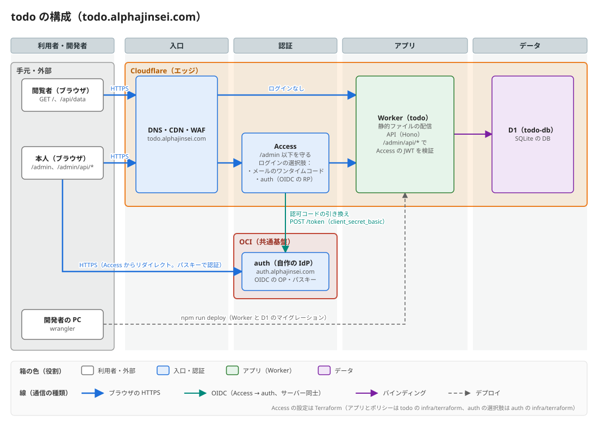

# todo.alphajinsei.com 設計

## 1. 目的

外部からの刺激がない長い休みの中で、自分の行動原理を本能の外に置くための仕組み。やることを書いておく場所と、**毎週何をやったかが人生の週のマスに積み上がっていく**場所を1つにする。

- 対象：個人開発、研究、勉強、読書など、自分の活動全般
- 期間：育休に限らず、ずっと使い続ける
- 公開する理由：見られている（かもしれない）ことを、守る力にする

## 2. 設計原則

| 原則 | 内容 |
|---|---|
| 使い勝手を仕組みより優先する | 面倒になって使わなくなるのが最悪の失敗。形式に縛らず、雑に増やせて雑に管理できるようにする |
| 細かさは自分で決める | タスクはタイトル・メモ・期限だけ。分けたければメモに書く（箇条書き、チェックリストなど自由） |
| やったことが残る | 完了したタスクは、その週の記録に自動で入る。完了しなくても、途中経過を記録できる |
| 切迫感は目に入れる | 期限の近さを色で、残り時間・人生の残り週数を常に出す |

### 経緯

最初は「法典」として、ACTIVE は3つまで、昇格には なぜ・成果物・次の一手・期限 が必須、期限は延期でしか変えられない、などのルールを持たせた。次に、実現したいこと（ゴール）とステップの2段、集中／じっくりの2つの枠に分けた。ローカルで触ってみると、どちらも書く形式に頭がとらわれて、自由にタスクを増やせなかった。そこでルールをすべて外し、タスクはタイトル・メモ・期限だけにした。代わりに「その週に何をやったか」を記録し、人生の週のマスで見えるようにした。

## 3. タスクと週の記録

### タスク

- タイトル・メモ・期限（任意）だけ。状態は「未完了」と「完了」
- メモはタスクのカードを押すと開閉する（ボタン・つまみ・入力欄を除く）。開閉はタイトルの左の三角（▸／▾）で、書き込みがあることはタイトルの右のメモのアイコン（≡）で分かる。「メモをすべて開く／閉じる」で一覧でも読める。編集画面では保存ボタンはなく、打つそばから保存される（手を止めて1秒後、欄を離れたとき、ページを閉じる・読み込み直す・別のタブに移るとき）。保存の状態は出さず、失敗したときだけ出す
- 縦は詰める。全部のメモを開いても、テキストエディタでタスクと小項目を書き連ねたくらいの密度で読めるようにする
- 期限は自由に変えられる。空にすれば期限なし
- 並び順：手で並べた順（カードの左の外のつまみをドラッグ）。新しいタスクは「いま」の線のすぐ下に入る。まだ並べ替えていないものどうしは、期限の近い順、期限なしは登録順
- 「いま」の線：一覧の途中に線を1本引き、その上に置いたものを「いま手をつけていること」とする。線をまたいでドラッグすれば上下が変わる。見た目の区切りだけで、上でも下でも、完了・やったこと・編集などできることは同じ。数の上限も置かない（何を上に置くかは人が決める）。新しいタスクを線の下に入れるのは、線の上を自分で選んだものだけにしておくため
- 削除してよい。削除しても、そのタスクから記録したことは残る
- 完了したタスクも、メモを未完了のときと同じように開いて読める。編集モードなら書き足せる（振り返りや、あとで思い出したことを残すため）

### 週の記録（やったこと）

- 1行＝「その日に何をやったか」。日付から、どの週（月曜〜日曜）に入るかが決まる
- **タスクを完了にすると、その日の記録が自動で1行入る**（文はタスクのタイトル。完了を取り消すと消える）
- タスクの「＋ やったこと」から、完了していなくても途中経過を残せる。その記録には、どのタスクのものかを小さく添える（完了の記録は文がタイトルそのものなので添えない）
- 週の欄から手で書き足せる。過去の週にもさかのぼって書ける（未来の日付は不可）

## 4. 画面構成

1. **残り時間の帯**：今週の残り（月曜始まり）／今年の残り／人生の残り週数（90歳まで）
2. **追加**：タイトル（と任意で期限）を入れて Enter
3. **タスク**：期限のバッジと左端の色で近さを出す（8日以上：グレー、7日以内：橙、2日以内・当日：赤、超過：赤背景）。カードの左の外にあるつまみ（⠿）をドラッグして、手で並べ替える。つまみは PC ではマウスを乗せたときだけ出し、スマホでは薄く常に出す。掴んだカードは指に付いて動き、ほかのカードは滑って場所を空ける（優先と思う順。期限では並べ替えない。新しいタスクは「いま」の線のすぐ下）。一覧の途中に細い線と小さく「↑ いま」。線の上が空のときは「いま手をつけるものを、この線の上へ」と出す（閲覧モードでは、線の上が空なら線を出さない）。線の上のカードの見た目は変えない。右端に、同じ形で位置のそろったボタン（＋ やったこと／✓ 完了／⋯）。⋯ はタイトル・期限の変更と削除のダイアログ。完了は確認のダイアログを出し、完了したら今週の欄でその記録を光らせる。完了したものは下の「完了」に畳んである（メモは開いて読め、編集モードでは書ける。「未完了に戻す」で取り消し）
4. **今週やったこと**（過去の週は「M/D〜M/Dの週にやったこと」）：既定は今週。「前の週／次の週」のボタンか、人生の週のマスを押して切り替える。書き足し。各行の ⋯ から書き直し・削除
5. **人生の週**：1マス＝1週間（月曜〜日曜）、1行＝1歳（誕生日を含む週から、次の誕生日を含む週の前まで）。1行は52マスにそろえ、53週ある歳（5〜6年に1回）は最後のマスに2週ぶんをまとめる、90行。過ぎた週（今週を含む）は一段濃い灰色、まだ来ていない週は薄い灰色で塗る（過ぎた週の一番右のマスが今週。枠線だけのマスは群体のように見えて落ち着かないので使わない。折りたたみは戒めとしてあえて入れない）。やったことがある週はオレンジで、量が多いほど鮮やかにする（GitHub の草と同じ。1件／2件／3〜4件／5件以上。暗くはしない。1件でもはっきりオレンジと分かる色から始める）。枠は選んでいる週だけ（初期値は今週）。期限は週ではなく日付で見るものなので、マスには出さない。マスにカーソルを当てると、その週にやったことが出る

期限を過ぎた・今日が期限のタスクがあると、ブラウザのタブのタイトルに `(2) todo` と件数が出る。

## 5. データモデル

Cloudflare D1（SQLite）に2つのテーブルを持つ。定義の正は `src/db/schema.ts`。

| テーブル | 中身 |
|---|---|
| `tasks` | `id`、`title`、`memo`、`deadline`（任意）、`status`（open / done）、`created`、`done`、`sort`（手で並べた順）、`focus`（「いま」の線より上か） |
| `records` | `date`、`text`、`kind`（done：完了で自動で入った／manual：手で書いた）、`task_id`（どのタスクから来たか。タスクを消すと空になる）、`created` |

- 日付はすべて `TIME_ZONE`（Asia/Tokyo）でのローカル日付 `YYYY-MM-DD` の文字列。「今日」はサーバーが決める
- 誕生日と寿命は `wrangler.jsonc` の `vars` に置く
- `GET /api/data` が全体を返す：`{ owner, tasks: [...], records: [...] }`

## 6. アーキテクチャ

方式②（Cloudflare Workers + Hono + D1 + Drizzle、Access は Terraform）。詳細は [README](../README.md)。



図は draw.io で編集できる（VSCode の拡張 Draw.io Integration で開く）。同じことを短く書くと：

```
閲覧者 ──GET /, /api/data───────────────▶ Worker ──▶ D1
本人   ──/admin, /admin/api/...───────▶ Access ──▶ Worker（JWT を検証）──▶ D1
```

- 画面は1つ（`public/index.html`）。URL が `/admin` なら編集モード、それ以外は閲覧モード
- 書き込みは操作ごとの API（タスクの追加・部分的な更新・削除・完了・取り消し、記録の追加・編集・削除）。完了と記録の自動追加は D1 の `batch`（1トランザクション）で行う
- 編集は本人1人なので、排他制御は持たない
- 守りは2重：Access が `/admin` 以下にログインを求め、Worker も `/admin/api/*` で Access の JWT（`aud` と発行者）を検証する。`ACCESS_AUD` が未設定なら書き込みは 403
- Access のログインは、メールのワンタイムコードと、自作の IdP の auth（OIDC。パスキーなど）のどちらでもよい。auth が落ちても編集できるように、ワンタイムコードは残す。Worker から見ると、どちらで入っても同じ Access の JWT が届く

### GitHub を保存先にする案をやめた理由

当初は「Pages + Pages Functions で、書き込みのたびに GitHub API で tasks.json を commit する」構成だった（commit の履歴がそのまま行動ログになる、という利点があった）。infra で方式を整理した結果、Pages は新規には使わない方式⓪になり、データを保存するアプリは方式②（D1）を使う決まりになったので、それに合わせた。

- 行動ログは週の記録（`records`）が担う
- トークンを Worker に持たせなくてよくなり、反映の遅れ（再ビルドの数十秒）もなくなった

### ローカル開発

`wrangler dev`（本番と同じ workerd、D1 は手元の SQLite）。`.dev.vars` の `DEV_SKIP_ACCESS=true` で Access の検証を飛ばす。見本のデータは `npm run seed:sample`。手順は README の3章。

### ディレクトリ構成

```
todo/
├─ docs/design.md          この文書
├─ README.md               構成・開発・デプロイ（サービス開発ガイドの6つの見出し）
├─ wrangler.jsonc          Worker、D1、vars
├─ src/
│  ├─ index.ts             API（Hono）
│  ├─ rules.ts             入力の検証、今日の日付
│  ├─ access.ts            Access の JWT の検証
│  └─ db/schema.ts         テーブル定義（tasks / records）
├─ migrations/             drizzle-kit が作る SQL
├─ public/                 画面（index.html / style.css / app.js）
├─ seed/                   見本のデータ（sample.json、tasks.json：最初期の形式。メモにまとめて読み込む）
├─ scripts/seed.mjs        見本のデータを手元の D1 に流す SQL にする
└─ infra/terraform/        Access（本人だけ /admin に入れる）
```

## 7. デプロイ時の作業（次のステップ）

1. GitHub に公開リポジトリ `alphajinsei/todo` を作って push する（コミットの作者のメールアドレスをどうするか先に決める）
2. `npx wrangler d1 create todo-db --location apac` → `database_id` を `wrangler.jsonc` に書く
3. `infra/terraform` で Access を作る（`owner.auto.tfvars` を用意 → `./tf.sh init` → `./tf.sh apply`）→ `access_aud` を `wrangler.jsonc` の `ACCESS_AUD` に書く
4. `npm run deploy`（カスタムドメイン `todo.alphajinsei.com` もこのとき作られる）
5. 確かめる：`/` はログインなしで見える、`/admin` はログインを求められる、ログイン後に追加・完了・記録ができる
6. infra の `.claude/settings.json` の `additionalDirectories` に `~/claude-sandbox/todo` を足す（infra から作業するとき）

注意：

- データはすべて公開される前提で書く（誕生日を含む）
- D1 と Workers の無料枠に十分収まる（1人で1日数十回の書き込み）

## 8. 今後の拡張候補

- **外からの刺激**：期限前のリマインド（Workers の Cron Triggers）。Claude Code のスケジュール実行で、週の記録を読んだ週次の振り返り。通知先はメールか Discord の webhook
- メモを公開しない設定（今はメモもすべて公開される）
